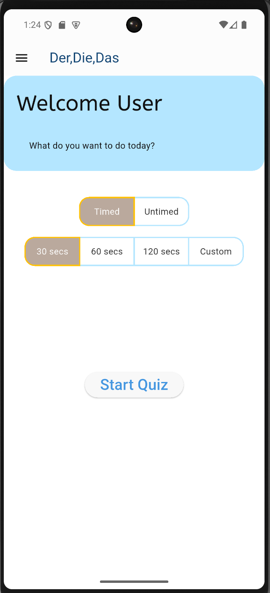
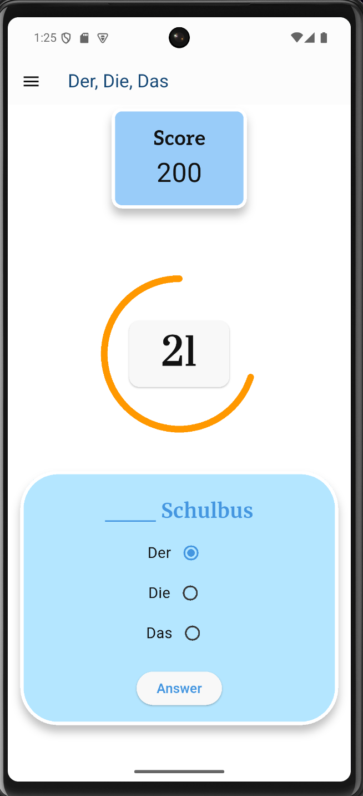
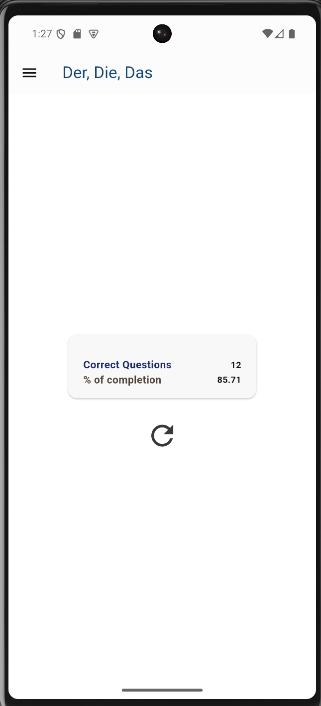

# Der Die Das — German Article Trainer

A Flutter quiz app for practising the hardest part of German nouns: their gender. Each card shows a noun and you pick **der**, **die** or **das**. Race the clock or choose how many questions to answer, then review your score.

<p align="center">
  
  
  
</p>

## Features
- **Two quiz modes**
  - **Timed:** answer as many nouns as you can in 30, 60 or 120 seconds, or a custom time (20–180 s) set with a slider.
  - **Untimed:** answer a fixed number of questions — 10, 25, 50 or a custom amount (20–150).
- **Live countdown** with a custom-painted circular timer.
- **Shuffled questions** from a Firebase Firestore question bank, cached after the first load.
- **Score and results summary** at the end of every round, with one-tap restart.
- **Settings drawer:** return to the main menu, dark mode, and "Show article", which previews your selected article in front of the noun before you confirm.
- **Custom UI:** custom-clipped menu items, toggle buttons for mode selection and a themed palette (flex_color_scheme).

## Tech stack
| Area | Choice |
|---|---|
| Framework | Flutter, Dart (^3.7) |
| State management | BLoC (flutter_bloc) — `QuestionBloc` for the quiz, `ThemeBloc` for settings |
| Architecture | Clean Architecture (presentation / domain / data) |
| Backend | Firebase Firestore |
| Dependency injection | get_it |
| UI | flex_color_scheme, google_fonts, CustomPainter, CustomClipper |

## Architecture
```
lib/
├── domain/                     # Pure Dart — no Flutter or Firebase imports
│   ├── entities/               # Question
│   ├── repositories/           # QuizRepository (abstract)
│   ├── contracts/              # Ticker (abstract time source)
│   └── usecases/               # GetQuestions, CheckAnswer, UpdateScore
├── data/
│   ├── datasources/            # QuizDataSource (abstract) + FirebaseQuizDataSource
│   ├── models/                 # QuestionModel (Firestore map → model)
│   ├── repositories/           # QuizRepositoryImpl (maps models to entities)
│   └── ticker/                 # RealTicker (Stream.periodic)
├── presentation/
│   ├── bloc/                   # QuestionBloc, ThemeBloc
│   ├── screens/                # Menu, Quiz, End
│   └── widgets/                # Question card, timer, menu toggles, slider, drawer
├── theming/
└── injection_container.dart    # get_it registrations
```

**Flow:** the menu dispatches `StartTimedQuiz` or `StartUntimedQuiz` to `QuestionBloc`. The bloc emits `QuizInProgress`, and a `BlocListener` on the menu navigates to the quiz screen in response. Answers go through the `CheckAnswer` and `UpdateScore` use cases; when the questions run out or the timer reaches zero, the bloc emits `QuizFinished` and the end screen shows the summary.

### Design decisions
- **Layers depend on abstractions.** The bloc only knows the use cases, the use cases only know `QuizRepository`, and the repository only knows `QuizDataSource`. Firestore is one implementation, registered in `injection_container.dart`, so it can be swapped (e.g. for a local word list) without touching the UI or business logic.
- **Models vs entities.** `QuestionModel` handles parsing Firestore data; `QuizRepositoryImpl` maps it to the domain `Question` entity, which also defines the three answer options.
- **The timer is injectable.** `QuestionBloc` depends on a `Ticker` interface instead of creating timers itself. `RealTicker` wraps `Stream.periodic` and stops at zero; in tests, a fake ticker can emit ticks instantly, so "quiz ends when time runs out" can be tested without waiting.
- **Safe timer restarts.** The bloc keeps the `StreamSubscription` and awaits its cancellation before starting a new one, so restarting a quiz never runs two timers at once.
- **Sealed states.** `QuestionState` is a sealed class (`QuestionsLoading`, `QuestionsLoaded`, `QuestionsError`, `QuizInProgress`, `QuizFinished`), so each screen handles every phase explicitly.

## Data model
Questions live in a Firestore collection called `questions`. Each document has:

| Field | Type | Example |
|---|---|---|
| `word` | string | `Tisch` |
| `correctAnswer` | string | `Der` |

## Getting started
Requirements: Flutter SDK (Dart ^3.7), an Android emulator or device, and a Firebase project with Firestore.

```bash
git clone https://github.com/soulandbone/der_die_das.git
cd der_die_das
flutter pub get
```

Firebase keys are kept out of the repository. Create `lib/secrets.dart` with the constants referenced in `lib/firebase_options.dart` (for example `API_KEY_ANDROID`, `APP_ID_ANDROID`, `PROJECT_ID_ANDROID`), using the values from your own Firebase project — or regenerate `firebase_options.dart` with `flutterfire configure`. Then add documents with the fields above to a `questions` collection and run:

```bash
flutter run
```

## Roadmap
- [ ] Restart a timed round with a fresh, shuffled set of questions
- [ ] Unit tests for the use cases and `QuestionBloc` (bloc_test + a fake `Ticker`), repository tests with a fake data source
- [ ] GitHub Actions CI (analyze + test on every push)
- [ ] Firebase Auth and per-user progress
- [ ] Spaced repetition: nouns you miss come back more often
- [ ] Word sets by level (A1–B2)
- [ ] Play Store release

## Author
Gustavo Pavez Gikis — Flutter developer · [LinkedIn](https://www.linkedin.com/in/gustavo-pavez-5ba72814a/) · [Portfolio](https://portfolio-gpg.vercel.app/)
